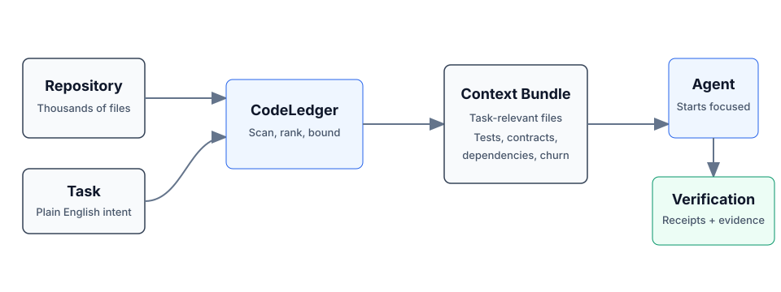

# CodeLedger

**Give AI coding agents the right repo context before they start - then verify
what changed.**

CodeLedger is local-first context control for AI coding agents. It scans a
repository, selects a bounded task-relevant set of files, and writes an
evidence-backed context bundle before the agent begins work.

Works with Claude Code, Codex, Cursor, GitHub Copilot, Gemini CLI, and other
CLI or MCP-compatible coding agents.

## Try It

```bash
npm install -g @codeledger/cli
cd your-project
codeledger ready --task "Fix null handling in user service"
```

CodeLedger initializes the repo if needed, refreshes the index, and creates the
task-specific bundle at `.codeledger/active-bundle.md`. Your agent reads that
artifact first so it starts with the files most relevant to the task.

Runtime analysis is local by default. Installing or updating may fetch packages
or release artifacts from npm and GitHub Releases; CodeLedger runtime analysis
does not send your source code through CodeLedger telemetry by default.



## Example Benchmark

Example result from a mid-sized Node.js service. Results vary by repository,
task, agent, and scenario.

| Metric | Without CodeLedger | With CodeLedger | Change |
| ------ | ------------------ | --------------- | ------ |
| Tests Passed | 78% | 94% | +16% |
| Iterations | 4 | 2 | -50% |
| Files Changed | 17 | 9 | -47% |
| Time to Finish | 6m 12s | 3m 40s | -41% |
| Token Usage | 28k | 18k | -36% |

Do not take the benchmark on faith - measure CodeLedger on your own repo:

```bash
codeledger compare \
  --scenario .codeledger/harness/scenarios/auth-rate-limit.json \
  --guided
```

If CodeLedger improves your coding-agent workflow, star the repo to follow
releases and help other developers discover it.

## Start Here

- [Getting Started](GETTING-STARTED.md)
- [CLI Reference](docs/CLI_COMMAND_REFERENCE.md)
- [How It Works](docs/ARCHITECTURE_OVERVIEW.md)
- [MCP Server](docs/MCP.md)
- [Feature Tiers](docs/FEATURE_TIERS.md)
- [Security](SECURITY.md)
- [Contributing](CONTRIBUTING.md)
- [Latest Release](https://github.com/codeledgerECF/codeledger/releases/latest)
- [npm package](https://www.npmjs.com/package/@codeledger/cli)

## How It Works

1. CodeLedger scans the repo for deterministic local signals such as dependency
   structure, churn, tests, contracts, and task keywords.
2. It ranks and packs a bounded set of task-relevant files.
3. It writes `.codeledger/active-bundle.md` for your coding agent.
4. After work, verification, receipts, and session summaries help show what
   changed and whether the selected context was useful.

Same task plus same repo state produces the same file ranking behavior.

## Core Capabilities

- **Give agents the right context:** deterministic file selection, scope
  inference, bounded budgets, blast-radius hints, and co-change context.
- **Keep work continuous:** session summaries, checkpoints, mid-session refine,
  and handoff/recovery commands.
- **Keep agents inside the task:** scope contracts, intent governance, loop
  detection, and multi-agent conflict checks.
- **Prove what happened:** review intelligence, receipts, provenance, audit
  exports, and release evidence.

For the full command surface, see the [CLI Reference](docs/CLI_COMMAND_REFERENCE.md).

## Agent Integration

Claude Code can use CodeLedger hooks after `codeledger ready` initializes the
repo. Cursor, Codex, GitHub Copilot, Gemini CLI, Aider, Windsurf, and other
agents can read `CLAUDE.md` plus `.codeledger/active-bundle.md`, or use the
repo-local wrappers when available.

CodeLedger also includes an MCP server for supported tiers:

```bash
codeledger mcp start
codeledger mcp status
```

See [MCP Server](docs/MCP.md) and [Feature Tiers](docs/FEATURE_TIERS.md) for
setup and tier details.

## Trust And Verification

- Runtime source analysis runs locally by default.
- Source code is not sent through CodeLedger telemetry by default.
- No account is required for the local CLI flow.
- Public releases include `SHA256SUMS` and release-evidence artifacts.
- `codeledger doctor` checks the local install, hooks, config, index, and ledger
  health.
- The public wrapper, docs, harness, and scanning surface are inspectable in
  this repo; the protected hardened runtime is covered by `LICENSE-CORE`.

## Install

```bash
npm install -g @codeledger/cli
codeledger --version
```

Or use the release zip:

1. Download the [latest release](https://github.com/codeledgerECF/codeledger/releases/latest).
2. Extract it.
3. Run `install.sh`.

The installer uses the bundled package from the zip, so the installed wrapper
version matches the release. The wrapper then fetches the matching hardened
binary from the GitHub release unless your environment already provides it.

## Everyday Flow

```bash
cd your-project
codeledger ready
codeledger ready --task "Fix null handling in user service"
```

Inside an initialized repo, you can also use:

```bash
codeledger activate --task "Fix null handling in user service"
codeledger doctor
```

Browser, cloud, and sandboxed environments can use the repo-local runtime
deployed under `.codeledger/bin/` after initialization or vendoring.

## Architecture

CodeLedger has an open public surface and a protected hardened runtime:

```text
PUBLIC:    CLI wrapper, types, repo scanner, harness, reports, docs, hooks
PROTECTED: Scoring engine, selection algorithm, confidence internals
```

Use `codeledger about`, `codeledger doctor`, and command-specific `--explain`
output to inspect behavior and evidence without exposing protected
implementation internals.

## Privacy

- Installation may use npm and GitHub Releases.
- Runtime analysis runs on your local machine by default.
- Runtime analysis makes zero source-code telemetry calls by default.
- Your source code is not required to leave your machine for the local CLI flow.
- Uninstall at any time.

## License

- Public wrapper, types, repo scanning, harness, reports, docs, and examples:
  [MIT](LICENSE)
- Downloaded hardened binary: [CodeLedger Core License](LICENSE-CORE)

GitHub may classify the combined licensing structure as "Other" because the
repo includes both MIT-covered public files and separately licensed protected
runtime terms. Changing the license files should be a human legal decision.

## Part Of ContextECF

CodeLedger applies Intelligent Context AI's context-control architecture to
software engineering. For enterprise-wide governed context across applications
and agents, see [ContextECF](docs/context-ecf.md).

CodeLedger is produced by Intelligent Context AI, Inc. See
[codeledger.dev](https://codeledger.dev).
